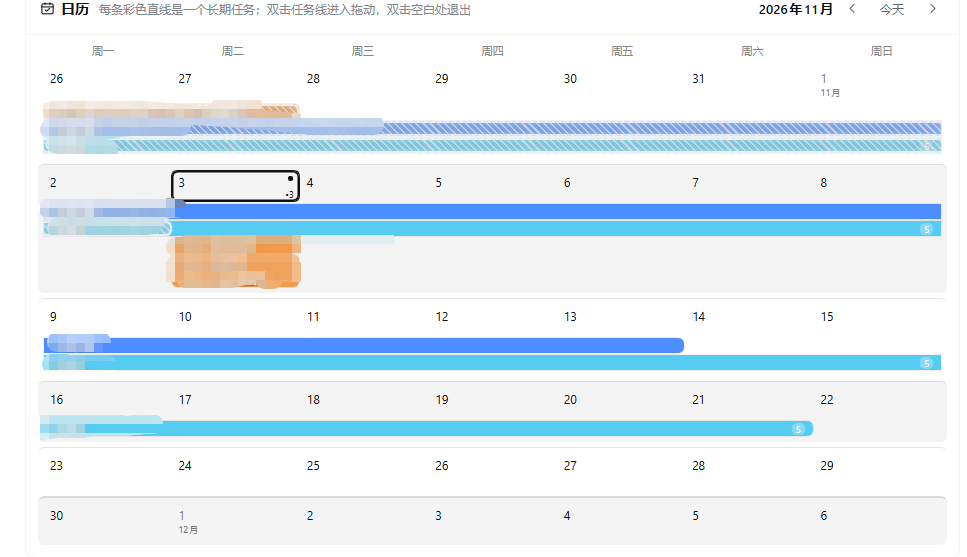

<p align="center">
  <a href="README.md">简体中文</a> ｜ <b>English</b>
</p>

# DailyBoard

DailyBoard — a daily work task board for the DSH Web GUI: a calendar showing one complete month, a daily checklist, week and day work views with a draggable 24-hour timeline, recurring and long-term task progress, **a daily email reminder that can be pushed to WeChat and used to remind other people such as partners or relatives**, and AI extraction of tasks from natural language.

<p align="center">
  
</p>
<p align="center">
  
  
</p>
<p align="center">
  
</p>
## Features

- **Calendar (one month)** — a complete calendar month (with the padding days of the first and last weeks; prev/next buttons switch months). Every long-term task is drawn as a colored timeline bar across its date range, and a timed day task is drawn as a single-day bar on its date (long-term tasks pack first, five lanes per week row with an expand button to show every task; recurring daily tasks are not drawn on the calendar). Bars are split per week, double-clicking a long-term bar enters drag mode (move the body, drag either end to resize), and days before today are rendered as a hazy gray band with fine diagonal hatching and a white glass-like outline. Selecting any bar shows that task's subtasks.
- **Daily tasks** — recurring daily habits in a rounded-square checkbox list (green filled with a white check when done); add, rename and delete.
- **Daily work, two views** — a seven-column week list (Monday to Sunday, page between weeks, past days tinted `#E5ECFD`, completion checkboxes for timed tasks and long-term projects; drag a task row onto another day of the week to reschedule it — timed day tasks and single-day tasks move, multi-day projects keep their range and are dragged on the calendar; click a task row that has subtasks to expand or collapse them inline, read-only, editing stays on the specific-day page; each day column has an **Add task** button at its bottom that opens the day-task editor preset to that date) and a specific-day view with the day's daily tasks, the day's tasks, and a 24-hour timeline whose blocks move by dragging and resize by dragging their edges (15-minute snapping, double-click empty space to add). Both left panels also have an **Add task** button at the bottom: the daily list adds a daily habit, the day-task list adds a timed task for that date.
- **AI extraction** — paste a Chinese schedule into the top bar, click extract, review the editable task drafts, then confirm to write them into the calendar, the daily checklist or a day plan. When the default model is unavailable, times out, or returns malformed output, a local rule-based parser takes over with a notice. **Smart date parsing**: a single date (today / tomorrow / Monday / Oct 12) with no clock time becomes a **day task**; a clock time becomes a scheduled task; only an explicit date range becomes a long-term task — so “print it today” is never treated as long-term. **“This week / this month” only covers the remaining days**: “finish the paper this week” becomes today → Sunday, “this month” becomes today → end of month; only with “already did / continue / completed” cues does it cover the whole week/month. **Press Enter to extract** (Shift+Enter for a new line).
- **Per-day completion for long-term tasks** — when a long-term task appears in the week list or the day view, checking it only means “I worked on this task that day”: it records that single date in `doneDates` and never marks the whole project or its other dates complete, and unchecking only removes that date.
- **Subtasks** — long-term tasks and timed day tasks can carry ordered subtasks. Long-term task subtasks are **per-day**: a subtask added on a given day in the specific-day view appears only on that day, never on the other days of the project range (each subtask carries a `date` in the store); timed day task subtasks belong to their slot. Indented lines in an extracted outline become subtasks of the task above them (attached to the task's first day). Selecting a task on the calendar shows its subtasks and clicking a week-list task row expands or collapses that day's subtasks; subtasks are added, renamed, checked and deleted only on the specific-day page, in their stored order (no drag reordering).
- **Weekly recurring tasks** — the add-task menu has a new “Weekly task” entry with two modes: **by weekday** (start date, one or more weekdays such as Monday + Wednesday, and how many weeks 1–52) and **every N days** (start date, interval in days 1–365, and how many weeks 1–52). Occurrences show up in the week list and the specific-day view, can be checked off occurrence by occurrence, and clicking one lets you edit the whole series (mode, weekdays/interval, weeks, start date) or delete it. **Each occurrence can also carry results as subtasks** (e.g. a blood-pressure reading 120/80 or weight 65.2 kg), scoped to that day.
- **Long-term progress (entry inside the calendar)** — click “Long-term progress” in the calendar card header to review recurring and long-term tasks: the left side lists tasks and the right side shows a date-descending history of completion marks and recorded results (blood pressure, weight, …); it is read-only and “← Back to tasks” returns to the calendar, with no separate panel or page.
- **Email reminder (WeChat & other recipients)** — sends a daily summary of today's tasks to a mailbox of your choice (QQ / 163 / 126 / Gmail / Outlook presets, or a custom SMTP host, port and SSL/STARTTLS; use the mailbox authorization code / app password, never the web password).
  - **To WeChat**: bind QQ Mail's “WeChat reminder” and each email shows up in WeChat, so you get the daily reminder right inside WeChat.
  - **For other people (partners, relatives, …)**: tasks can be marked “For others” — the dropdown is filled from the extra recipients you added (shown as “note (email)”), and those items are listed separately in the digest; add extra recipients in the reminder card with “+ Add recipient” — each one has an email, a note and its own send time, and receives the daily digest independently. For example, remind a partner to submit materials or a relative to take medicine and measure blood pressure.
  - A “Send test” button is included and the authorization code stays only on the local machine.
- **Persistence** — autosave to `<DSH_HOME>/task-board/data.json` with validation and atomic writes; autosave pauses if the file cannot be read, so a corrupt file is never overwritten.

## Example: email reminders for other people (partners / relatives)

1. In the email reminder card at the bottom of the page, click “+ Add recipient”, enter the other person's email, a note (such as “Mr. Wang” or “Mom”) and its own send time, then save.
2. When adding a task, **the “For others” dropdown automatically lists the recipients you just added** (shown as “note (email)”); pick the right person.
3. Save the task; back in the reminder card click “Test” on that row to confirm they receive it.
4. At the scheduled time the digest arrives with the “For others” items listed separately (with note and email).
5. For WeChat: have them bind QQ Mail's “WeChat reminder” so the mail is pushed to WeChat; email alone works too.

> Email itself is the reminder channel; WeChat is just an extra way to receive it. QQ Mail's WeChat reminder is bound at QQ Mail web → Settings → Reminder service.

## Install

```sh
dsh plugin --profile web add dsh-dailyboard
# or
dsh plugin --profile web add github:GinoXiang/dsh-dailyboard
```

Requires DSH `>= 0.2.1-rc.2`. Restart DSH or refresh the Web GUI after installing; a "DailyBoard" icon appears in the sidebar.

## Data and permissions

- Reads and writes only `<DSH_HOME>/task-board/data.json` (default `~/.dsh/task-board/data.json`).
- The default model is called once per explicit AI-extract click; nothing is fetched in the background and no file content is sent.
- Three local HTTP endpoints (`/task-board/load`, `/task-board/save`, `/task-board/extract`) accept loopback, same-origin POST requests only, with a 2 MB body cap.
- No third-party runtime dependencies; the client uses the React instance and theme tokens provided by the DSH Web GUI.

## License

MIT
---

<p align="center">


</p>

> Just for fun — not related to the plugin itself. Thanks to the meme creator for the meme art and to the creator of the 大肥鱼 (big fat fish) character.
