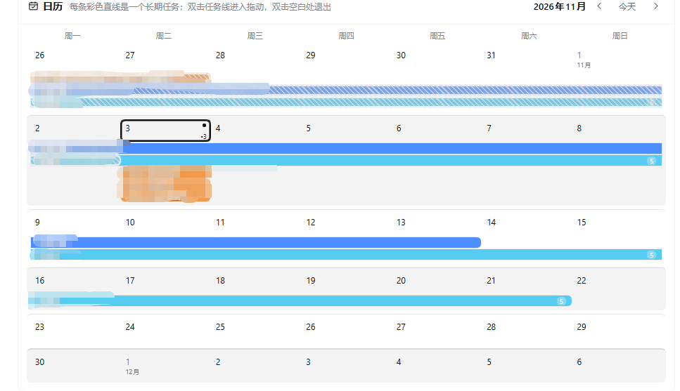

<p align="center">
  <b>简体中文</b> ｜ <a href="README.en.md">English</a>
</p>

# DailyBoard · 日常工作任务板

DailyBoard 是 DSH Web GUI 的日常工作任务板：单月日历（完整自然月）、日常清单、每天工作视图与可拖拽的 24 小时时间轴，支持周期任务、长期任务进展、**可推到微信、也能提醒他人（如合作伙伴或亲属）的每日邮件提醒**，并可用自然语言让 AI 提取任务。

<p align="center">
  
</p>
<p align="center">
  
  
</p>
<p align="center">
  
</p>

## 功能

- **单月日历**：完整自然月网格（含月初/月末补齐的周，左右按钮切换上/下月）；每个长期任务按起止日期画成一条彩色时间条，当天的定时任务也会作为单日条画在对应日期上（长期任务优先排布，每周最多显示 5 行，点「还有 N 项」可展开显示全部；日常任务不显示在日历上）。跨周自动分段；双击长期任务线条进入拖动模式（拖线身移动日期、拖两端改长度）；已度过的日期段用浅灰雾面 + 细斜纹 + 白色毛玻璃描边标出；单击任一条线可查看该任务的子任务。
- **日常任务**：每天重复的习惯清单，圆角方块勾选框（完成时绿色实心 + 白色对勾）；可增删改。
- **每天工作**：按钮切换两种视图。
  - **任务列表**：周一至周日 7 个竖列，左右翻页切换周；已过去日期背景为 `#E5ECFD`；只列非日常任务（定时任务与跨天长期任务），每行带完成勾选框；**按住任务行可拖到本周其他日期改期**（当天定时任务和单日任务可拖，多日长期任务请在日历里拖动调整范围）；**点击带子任务的任务行可展开/收起子任务**（只读，编辑仍在「具体当天」页）；**每列底部有「＋ 添加任务」**，点开即可给该天新建当天任务。
  - **具体当天**：左侧「当天日常」与「当天任务」两个清单，右侧 24 小时纵向时间轴；方块可拖动移动、拖上下边缘改起止（15 分钟吸附），双击时间轴空白处快速新建；点方块可编辑；**两个清单底部都有「＋ 添加任务」按钮**（日常清单加日常任务，当天任务清单加当天的定时任务）。
- **AI 提取**：页面顶部输入一段中文安排（例如「下周一至周五完成季度报告；每天锻炼 30 分钟；今天 14:00-15:30 开例会」），点击提取后调用当前默认模型解析为可编辑的任务草案，确认后写入日历 / 日常清单 / 当天安排。模型不可用、超时或返回格式异常时自动降级为本地规则解析，并给出提示。**自动识别日期**：看到「今天 / 明天 / 周一 / 10月12日」等单日日期且没有具体钟点时生成「当天任务」；带钟点生成定时任务；只有明确的起止日期范围才生成长期任务——「今天打印」不会再被误判成长期任务。
- **长期任务按天完成**：长期任务出现在任务列表 / 具体当天时，勾选只表示「这一天做了这个任务的相关工作」，只影响当天（记录在 `doneDates`），不会把整个项目标记为完成；取消勾选也只影响当天。
- **子任务**：长期任务和当天定时任务都可以带**有序子任务**。长期任务的子任务**按天记录**：在「具体当天」某天添加的子任务只显示在那一天，不会出现在该任务覆盖的其它日期（数据结构里每个子任务带 `date`）；当天定时任务的子任务属于该定时任务本身。AI 提取时缩进行会自动归到上一行任务名下（归到任务首日）。选中日历上的任务可查看子任务，周视图点任务行可展开/收起当天子任务；子任务只能在「具体当天」页增删改，顺序固定、不支持拖动重排。
- **周期任务**：添加任务里新增「周期任务」，支持两种模式：
  - **按周几**：选择开始日期、每周几（可多选，例如周一 + 周三）、持续几周（1–52）；
  - **每几天**：选择开始日期、每隔几天（1–365）、持续几周（1–52）。
  出现时会在任务列表和「具体当天」里自动显示，可逐次勾选完成；点击任务可编辑整组（模式、星期/间隔、周数、开始日期）或整组删除。**每次出现都可以添加结果（子任务）**，比如血压 120/80、体重 65.2kg，记录只属于当天。
- **长期任务进展（日历内入口）**：在「日历」标题栏右侧点「长期任务进展」即可查看周期任务与长期任务的历史：左侧列任务，右侧按日期倒序汇总每一项的完成标记和当天记录的结果（如血压/体重），用来回看长期变化；只读展示，点「← 返回任务」回到日历，不需要单独的面板或页面。
- **邮件提醒（可推到微信、可提醒他人）**：每天定时把「今日任务摘要」发送到指定邮箱（QQ / 163 / 126 / Gmail / Outlook 预设，也可自定义 SMTP 服务器、端口与 SSL/STARTTLS；密码用邮箱授权码/应用专用密码）。
  - **推到微信**：在 QQ 邮箱设置里开启并绑定「微信提醒」后，邮件到达时会直接出现在微信里，相当于每天用微信收任务提醒。
  - **提醒他人（如合作伙伴或亲属）**：任务可以标记「给他人」——下拉框的选项来自你在「其他收件邮箱」里添加的邮箱（显示为「备注（邮箱）」），摘要里会单独列出这些事项；邮件提醒卡片里点「＋ 增加收件邮箱」，每个邮箱可填备注和单独的定时时间，到点就会单独把当天摘要发给对方。例如提醒合作伙伴交材料、提醒亲属吃药量血压。
  - 设置里带「发送测试」按钮，授权码只存在本地。
- **持久化**：改动自动保存到 `<DSH_HOME>/task-board/data.json`；写入前做字段校验与原子重命名，读取失败时暂停自动保存以免覆盖原文件。

## 场景示例：用邮件提醒他人（合作伙伴 / 亲属）

1. 先在页面底部「邮件提醒」卡片里点「＋ 增加收件邮箱」，填写对方邮箱、备注（如“王工”“妈妈”）和单独的发送时间，保存。
2. 添加任务时，**「给他人」下拉框会自动列出你刚添加的收件人**（显示为「备注（邮箱）」），选中对应的人即可。
3. 把「给他人」选好后保存任务；再回到邮件提醒卡片，点该邮箱的「测试」确认对方能收到。
4. 到点后对方会收到当天摘要，其中「给他人」的事项会单独列出（带备注和邮箱）。
5. 对方微信：用 QQ 邮箱开启并绑定「微信提醒」，邮件就会推到微信；不绑微信也能直接看邮件。

> 邮件本身就是提醒渠道，微信只是多一种接收方式。QQ 邮箱的「微信提醒」在网页版 QQ 邮箱 → 设置 → 提醒服务里绑定。

## 安装

插件需要 DSH `>= 0.2.1-rc.2`。任选一种：

```sh
# 从 npm 安装（发布后可用）
dsh plugin --profile web add dsh-dailyboard

# 或直接从 GitHub 安装
dsh plugin --profile web add github:GinoXiang/dsh-dailyboard
```

安装后重启 DSH 或刷新 Web GUI，侧边栏会出现「DailyBoard」图标，点开即进入任务面板。

## 数据与权限

- 只读写 `<DSH_HOME>/task-board/data.json` 一个 JSON 文件（默认 `~/.dsh/task-board/data.json`）；卸载插件不会删除该文件。
- AI 提取只在点击「AI 提取」时调用一次当前配置的默认模型，不会后台自动请求；不发送文件内容，只发送输入框里的文本。
- Host 端提供三个本地 HTTP 接口（`/task-board/load`、`/task-board/save`、`/task-board/extract`），仅接受回环地址与同源请求，只支持 POST，请求体上限 2 MB。
- 无第三方运行时依赖；客户端使用 DSH Web GUI 自带的 React 与主题 token。

## 开发

```
index.js           Host 半：三个本地接口、JSON 存储、LLM 提取 + 本地降级解析
client.js          Client 半：侧边栏图标与整页 UI（plain JS，无需构建）
cordis.patch.yml   插件插入补丁
locale/en.json     插件显示名与描述（英文）
locale/zh.json     插件显示名与描述（中文）
icon.svg           插件图标
```

修改 `client.js` 或 `index.js` 后，在插件管理中禁用再启用该 bundle 即可让客户端半重新加载。

## License

MIT
---

<p align="center">


</p>

> 仅供图一乐，与插件功能无关；感谢 meme 创作者的表情包素材，感谢「大肥鱼」形象的创作者。
